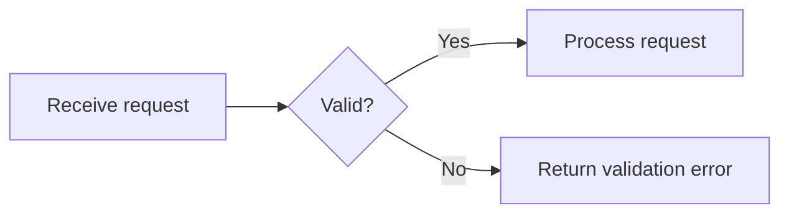

# Mermaid Diagrams

Produce a diagram that answers the user's question and remains easy to edit in its destination.

## Scope and diagram choice

- Preserve the requested notation, source file, language, and delivery format. A small edit should retain the existing diagram's structure and styling unless the requested change requires more.
- Choose the view from the question being answered. An architecture request does not require a C4 hierarchy, a database schema, or a source-code audit. Use supplied facts first; inspect relevant implementation only when the requested diagram needs it.
- Keep facts, proposals, and unknowns distinct. Do not invent components, calls, cardinalities, protocols, or behavior to fill a view.
- A diagram should clarify a relationship, sequence, state, or decision. Ordinary prose or a table may be sufficient. For publication-quality research figures, use the document's scientific and layout requirements rather than treating Mermaid as the default.

Read only the reference needed for the chosen view:

| Question | View and reference |
| --- | --- |
| What happens next; where does a decision branch? | [Flowchart](references/flowcharts.md) |
| Who calls whom, and in what order? | [Sequence](references/sequence-diagrams.md) |
| What classes or domain concepts relate? | [Class](references/class-diagrams.md) |
| What entities and cardinalities are modeled? | [ERD](references/erd-diagrams.md) |
| What systems, applications, or components are in scope? | [C4 syntax](references/c4-diagrams.md), when that notation is useful |
| How are infrastructure resources connected? | [Architecture syntax](references/architecture-diagrams.md), when supported by the renderer |
| How should styling, layout, embedding, or export work? | [Configuration and export](references/advanced-features.md) |

For other types, consult the relevant [official syntax documentation](https://mermaid.js.org/intro/syntax-reference.html), such as [state diagrams](https://mermaid.js.org/syntax/stateDiagram.html), [Gantt](https://mermaid.js.org/syntax/gantt.html), or [git graphs](https://mermaid.js.org/syntax/gitgraph.html). Verify less familiar syntax against the renderer's version.

## Author and refine

1. Identify the intended reader, the specific question, and the target document or renderer from the request. Ask only if an unresolved choice changes the result.
2. Include the elements and relationships needed for that question. Use stable, simple IDs and readable labels; keep related diagrams' names consistent.
3. Select direction and grouping for the available page width. Shorten labels or split views when the result becomes unreadable; do not shrink text to fit an overloaded canvas. Use color and shape consistently, with labels carrying the meaning.
4. Render the changed diagram when a compatible tool or preview is available. Inspect labels, crossings, arrow direction, clipped content, contrast, and legibility at the intended size; patch and rerender affected output.
5. Return or save the requested Mermaid source and any requested export. Briefly state assumptions and the checks actually performed. Syntax validation alone does not establish visual quality or factual accuracy.

A small flowchart can start with:

## Compatibility and verification

- Use the destination's renderer when possible. Mermaid versions, enabled diagram types, fonts, icons, configuration, and security settings differ between hosts. A successful local render does not prove the same result in GitHub, Notion, an editor, or a slide exporter.
- Prefer existing local tooling. With Mermaid CLI available, export an image for inspection, for example `rtk proxy mmdc -i diagram.mmd -o diagram.svg`. Use the command without the RTK prefix where RTK is unavailable. Check `mmdc --help` before relying on version-specific flags.
- If the target renderer rejects a feature, simplify while preserving meaning or propose a compatible notation. Do not silently change the requested notation. Avoid global installation or host configuration changes solely to obtain a preview.
- If rendering is unavailable, check the source against the applicable syntax and explicitly report that rendering and visual inspection were not performed. Do not claim a diagram is validated from a code block alone.
