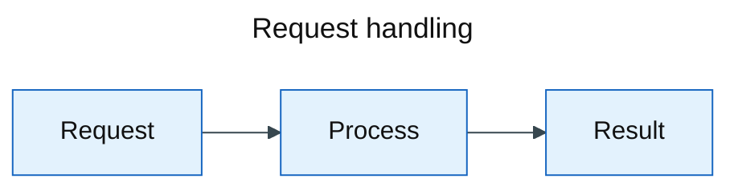
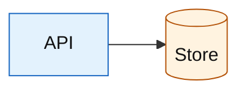

# Configuration, layout, and export

Read this reference when a task needs styling, host integration, or exported images. Preserve an established document's theme and rendering pipeline.

## Configuration and appearance

Use diagram frontmatter where the destination supports it:



Established themes include `default`, `forest`, `dark`, `neutral`, and `base`; newer releases may add themes and change per-diagram defaults. Use `base` for `themeVariables` customization and hexadecimal color values. Dark colors alone do not guarantee a readable dark-background export; inspect text, lines, and background together.

Legacy `%%{init: ...}%%` directives exist, but prefer supported frontmatter for new configurations. Hosts can restrict configuration and interactions. Do not change host security settings just to enable a diagram feature.

For flowchart-specific styling:



## Layout decisions

- Choose `LR` for a short horizontal flow and `TD`/`TB` for a taller page; use the direction appropriate to the selected diagram type.
- Dagre and ELK availability and defaults vary by Mermaid version, build, and integration. Test the target renderer before specifying `config: { layout: elk }`. Older integrations may require explicit ELK registration; a setting alone does not prove it is active.
- Try a supported alternative layout when crossings or clustering are poor. A node-count threshold does not determine the best layout. Edge merging can obscure separate relationships, so enable it only when meaning remains clear.
- `look: classic` and `look: handDrawn` are version-sensitive appearance choices, not substitutes for layout. Verify support for the selected diagram type.
- Shorten labels, reduce irrelevant detail, or split a view before shrinking text below the document's readable size. Check the actual destination width and fonts.

## Local export

Use an existing Mermaid CLI and check its available flags. With RTK available:

```bash
rtk proxy mmdc --version
rtk proxy mmdc --help
rtk proxy mmdc -i diagram.mmd -o diagram.svg
rtk proxy mmdc -i diagram.mmd -o diagram.png -b transparent
rtk proxy mmdc -i diagram.mmd -o diagram.pdf
```

Use equivalent commands without the RTK prefix if RTK is unavailable. Keep exports in the requested output location or a temporary inspection directory; keep editable source in the requested artifact. Avoid adding a global dependency solely for a one-off preview when an existing renderer is available.

CLI `-w` and `-H` set the browser viewport; they do not promise an exact final diagram size or fix unreadable content. Use the documented scale or PDF fitting flags when appropriate and inspect the exported dimensions. SVGs may depend on fonts or HTML labels that behave differently in downstream PDF, document, or image converters. Verify the asset in its final document when that is the deliverable.

## Embedding and verification

Markdown hosts generally use fenced `mermaid` blocks where enabled. Support for diagram types, frontmatter, links, fonts, and icon packs varies. Test the destination rather than claiming universal support across GitHub, GitLab, Notion, Obsidian, or Confluence.

For application integration, reuse the project's Mermaid setup and version. Consult the [API documentation](https://mermaid.js.org/config/usage.html) rather than adding a second global initializer or copying a version-pinned CDN snippet into unrelated code. Dynamic rendering needs the framework's lifecycle and Mermaid's current rendering API.

Check the rendered diagram for clipping, overlapping labels, wrong arrow direction, crossings that obscure meaning, font substitution, and contrast. Include a text explanation or accessible title/description appropriate to the host when readers need it. Do not rely on color alone for categories or status.

A parser check establishes syntax only. A successful local export establishes that tool's behavior only. State the renderer/version used and distinguish source review, rendering, visual inspection, and final-document checks; report unavailable checks directly.

Sources: [configuration](https://mermaid.js.org/config/configuration.html), [theming](https://mermaid.js.org/config/theming.html), [layouts](https://mermaid.js.org/config/layouts.html), and [Mermaid CLI](https://github.com/mermaid-js/mermaid-cli).
