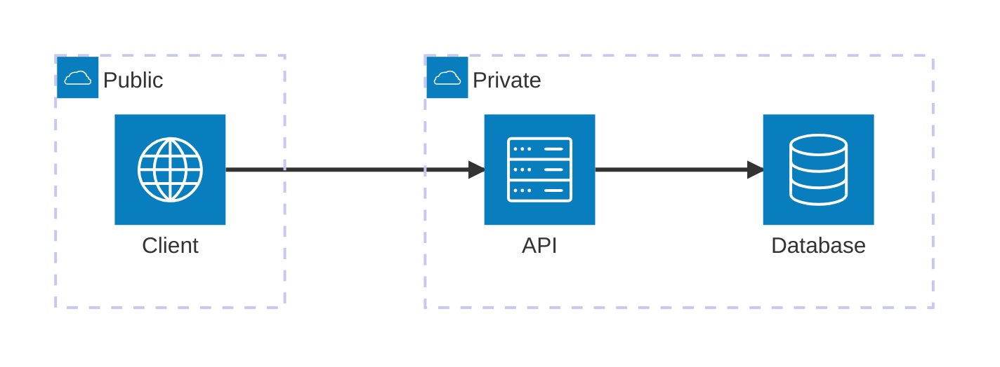
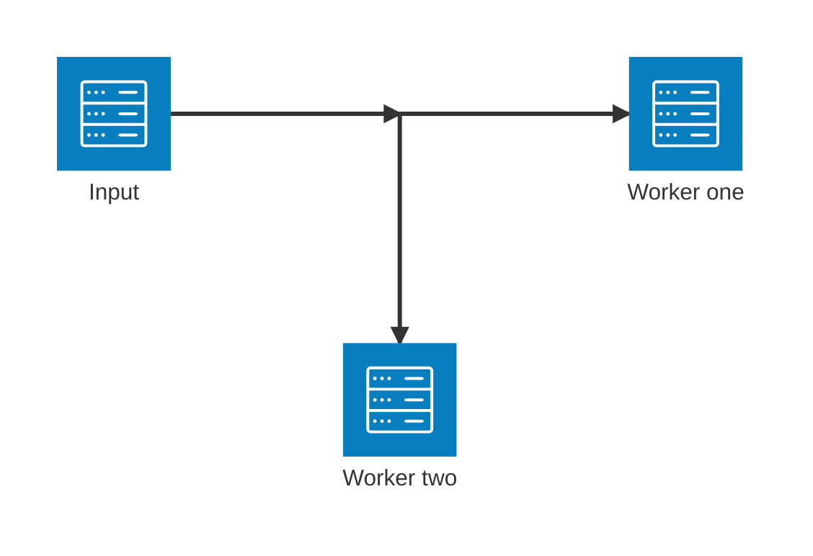

# Infrastructure architecture syntax

Use `architecture-beta` for service/resource topology when that notation fits the task and the destination supports it. It was introduced in Mermaid 11.1.0 and remains version-sensitive. A normal flowchart may be more portable when labels or target-host support matter more than infrastructure icons; preserve an explicit user choice.

## Groups, services, and edges



- `group id(icon)[Label] in parent`: group nested in a previously declared group; omit `in parent` at the top level.
- `service id(icon)[Label] in groupId`: service inside a group. The parent is a group ID, not another service.
- `a:R --> L:b`: edge leaving A's right and entering B's left. Endpoint sides are `L`, `R`, `T`, `B`; `--`, `-->`, `<--`, and `<-->` control arrowheads.
- Declare referenced identifiers first. Group related resources according to the requested topology rather than forcing frontend/backend or public/private layers.

## Junctions and group boundaries



A junction is a routing point, declared with `junction id` and optionally `in groupId`. It does not represent a queue, load balancer, or other service unless the model separately includes that service.

For edges that visually reach a group boundary, apply `{group}` to a service in that group, for example `client:R --> L:api{group}`. Do not use the group ID itself as a service endpoint. Inspect grouping and arrow placement in the render.

## Icons and portability

Built-in icons are `cloud`, `database`, `disk`, `internet`, and `server`. Names such as `browser`, `redis`, `api`, and `load_balancer` are not built-in icons. Custom icons require a registered pack and its exact prefix and icon name, such as `logos:docker`.

With a CLI that supports the flag, an icon-pack render may use:

```bash
rtk proxy mmdc --iconPacks @iconify-json/logos -i diagram.mmd -o diagram.svg
```

Check the installed CLI's help and the host's icon registration first. A local CLI may fetch the pack during rendering; successful rendering there does not prove a hosted Markdown integration has that pack. Use built-ins when custom packs are unnecessary.

Architecture syntax has its own grammar. Do not copy flowchart edge labels, quoted-label forms, layout options, or styling into it without confirming support. If protocols or long annotations are essential and unsupported, use nearby prose or discuss a compatible view. Check labels, service positions, group boundaries, and edge crossings in the final render.

See [official architecture syntax](https://mermaid.js.org/syntax/architecture.html) and [icon registration](https://mermaid.js.org/config/icons.html) for supported features in the target version.
