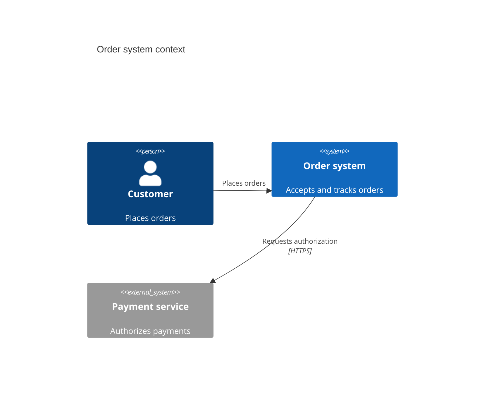
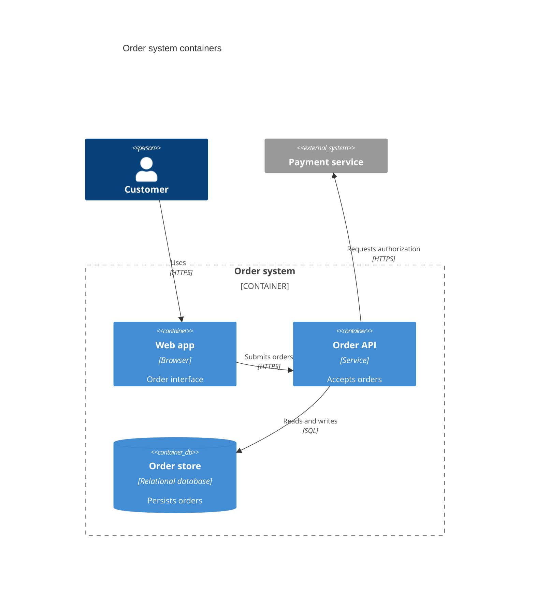
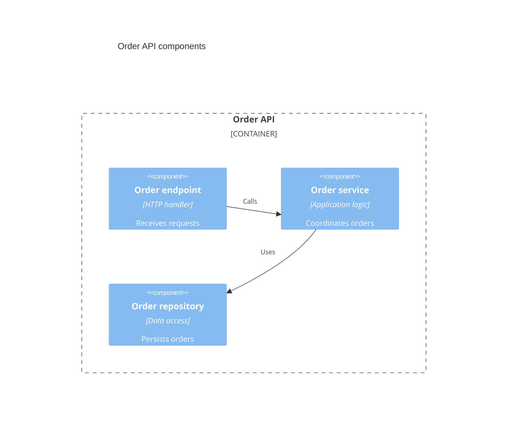

# C4 syntax in Mermaid

Use C4 when its architecture vocabulary helps answer the requested question. Select the needed view; a request for one container diagram does not require context, component, or code diagrams as additional deliverables.

| View | What it shows |
| --- | --- |
| `C4Context` | A system, its people, and neighboring systems |
| `C4Container` | Applications and data stores within a system |
| `C4Component` | Components inside a selected application |
| `C4Dynamic` | Numbered interactions among architectural elements |
| `C4Deployment` | Deployment nodes and deployed elements |

A C4 container is an application or data store, not necessarily a Docker container. Keep the selected abstraction consistent. Use class syntax for a code-level view when requested.

## Context

## Containers

## Components

These are notation examples. Include technologies and protocols only when supplied, verified, or explicitly proposed. Keep a reusable ID unique across people, systems, containers, and boundaries.

## Elements and relationships

- `Person(id, "Name", "Description")`; `Person_Ext` for an external person.
- `System`, `SystemDb`, `SystemQueue` and their `_Ext` variants.
- `Container(id, "Name", "Technology", "Description")`; `ContainerDb` and `ContainerQueue`, with `_Ext` variants.
- `Component(id, "Name", "Technology", "Description")`; database, queue, and external variants where supported.
- Boundaries include `System_Boundary`, `Container_Boundary`, and `Enterprise_Boundary`; their names identify the boundary being depicted rather than a demand for extra layers.
- `Rel(from, to, "Action", "Technology")` gives direction and an optional technology. Use separate directed relationships when a bidirectional line would conceal different meanings; `BiRel` is available when it represents the intended relationship.

## Layout limits

Mermaid implements a subset of C4-PlantUML. Do not assume PlantUML macros, `Lay_*` directives, legends, tags, or links work. Layout is influenced by declaration order and `UpdateLayoutConfig($c4ShapeInRow="3", $c4BoundaryInRow="1")`, rather than the ordinary flowchart layout settings. Use `UpdateRelStyle(a, b, $offsetX="10", $offsetY="-10")` only after rendering identifies a label collision. `UpdateElementStyle` can adjust an element; ordinary Mermaid themes may not control C4's palette.

The sample label offsets address collisions observed with Mermaid CLI 11.14.0; recheck them in the destination renderer. For dynamic/deployment syntax or additional options, consult the [official C4 documentation](https://mermaid.js.org/syntax/c4.html). This reference has no dependency on a separate C4 skill.
