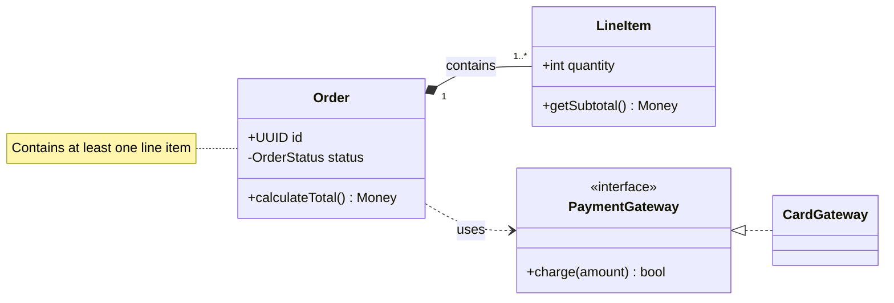
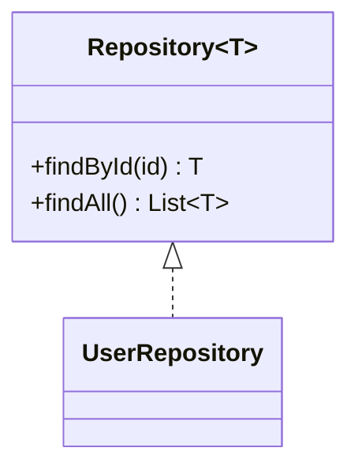

# Class diagrams

Use class diagrams for classes or conceptual domain relationships. Match the requested abstraction; a conceptual model need not include implementation methods or every field.

## Members and relationships

Visibility: `+` public, `-` private, `#` protected, `~` package/internal. Methods have parentheses; put a space between `)` and a return type. Append `*` for abstract members (`+draw()*`) or `$` for static members (`+create() Shape$`). Add annotations such as `<<interface>>`, `<<abstract>>`, and `<<enumeration>>` inside a class when relevant.

| Example | Meaning and direction |
| --- | --- |
| `Parent <|-- Child` | Child inherits from Parent |
| `Interface <|.. Implementation` | Implementation realizes Interface |
| `Whole *-- Part` | Composition, diamond at Whole |
| `Collection o-- Item` | Aggregation, diamond at Collection |
| `Caller --> Target` | Directed association |
| `Caller ..> Dependency` | Caller depends on Dependency |
| `A -- B` / `A .. B` | Solid / dashed link |

Use composition only when the supplied model implies strong lifecycle ownership. A database foreign key alone does not establish composition. Put multiplicity in quotes beside the relevant endpoint: `Customer "1" --> "0..*" Order : places`. Common values are `1`, `0..1`, `0..*`, and `1..*`; do not invent them from naming alone.

## Generics and notes

Mermaid uses tildes for generic types. Reference a generic class by its base ID (`Repository`), because type arguments are not part of its identity. Separate classes with the same name and different type arguments are not supported; comma-containing generics are also limited. Use a simpler display type or a note when necessary, then verify the result.

Use `note "General note"` or `note for Order "Order-specific invariant"` for constraints that do not fit a relationship. Omit routine members when they obscure the relationship the user needs.

See [official class syntax](https://mermaid.js.org/syntax/classDiagram.html) for namespaces, aliases, styling, and other version-specific features.
