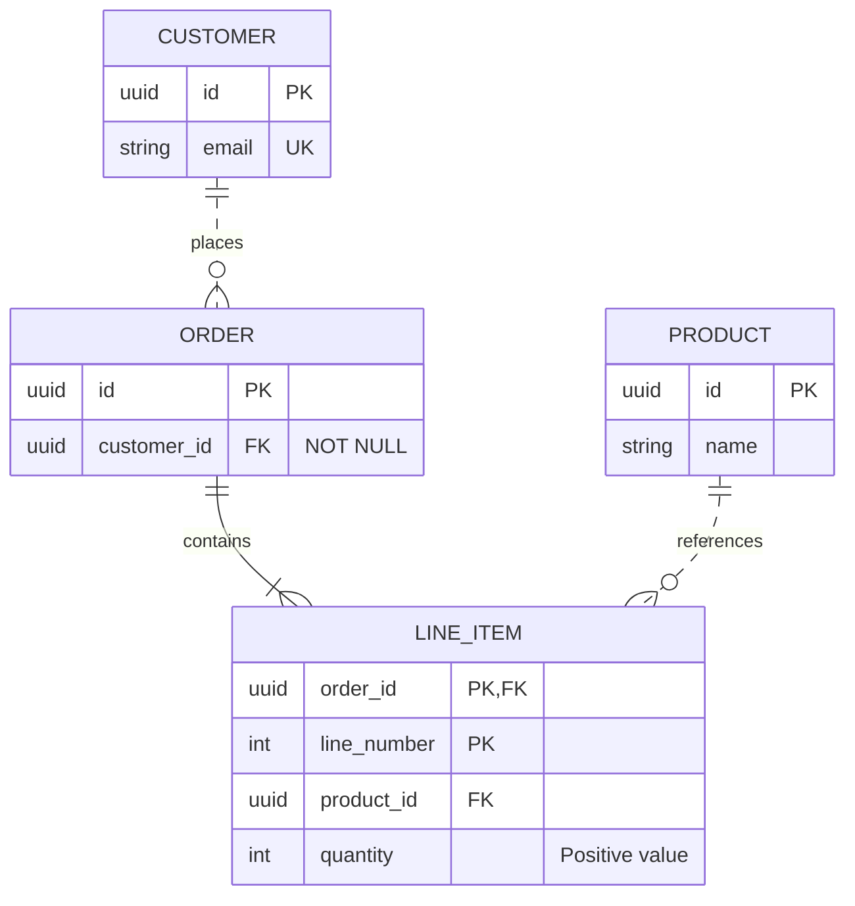
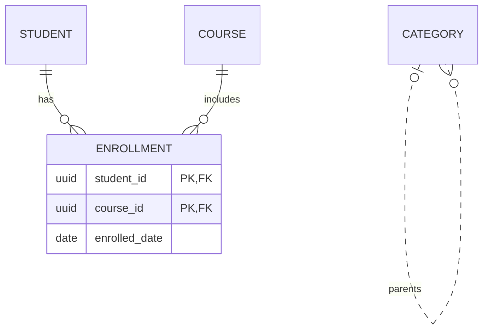

# Entity relationship diagrams

Use an ERD for entity relationships or a supplied relational schema. Establish whether the view is conceptual or physical; include columns, keys, and storage details only when they belong to the requested model.

## Cardinality and line meaning

A relationship has the form `ENTITY_A <left endpoint><line><right endpoint> ENTITY_B : label`.

| Cardinality at that entity | Left endpoint | Right endpoint |
| --- | --- | --- |
| Exactly one | `||` | `||` |
| Zero or one | `|o` | `o|` |
| One or more | `}|` | `|{` |
| Zero or more | `}o` | `o{` |

`--` is an identifying relationship (solid); `..` is non-identifying (dashed). These are separate from cardinality and optionality. Match their meaning to the model instead of selecting a line style for appearance.

Here an order belongs to exactly one customer; a customer may place zero or more orders. Each order has at least one line item, whose identity includes its order. This is an illustrative model, not a default schema to impose.

## Attributes and constraints

Attribute syntax is `type name [key] ["comment"]`. Supported key markers are `PK`, `FK`, and `UK`; separate multiple markers with commas, such as `PK, FK`. Nullability, defaults, checks, and indexes are descriptive comments, not additional key tokens: use `string name "NOT NULL"`, not `string name NN`.

Type names are labels, not validated SQL types. They begin with a letter and may include digits, hyphens, underscores, parentheses, and brackets. Keep complex SQL declarations in accompanying prose if the parser cannot represent them. Attribute comments cannot contain double quotes. Singular names are useful; uppercase is a convention rather than a syntax requirement.

## Common structures

For a physical many-to-many model, show the supplied junction table and its keys. Avoid also drawing a direct many-to-many edge unless it adds a clearly labeled conceptual view.

A self-reference needs role labels to distinguish parent/child or sender/recipient roles. A polymorphic ID does not automatically establish an enforceable foreign key to several tables; label the conceptual association rather than inventing constraints. Preserve supplied schema names, cardinalities, and optionality. Do not add audit columns, soft deletes, surrogate keys, or denormalization solely because an example used them.

Render the selected entities and key combinations; review cardinalities independently of parser success. See [official ERD syntax](https://mermaid.js.org/syntax/entityRelationshipDiagram.html) for direction, aliases, styling, and version-specific features.
