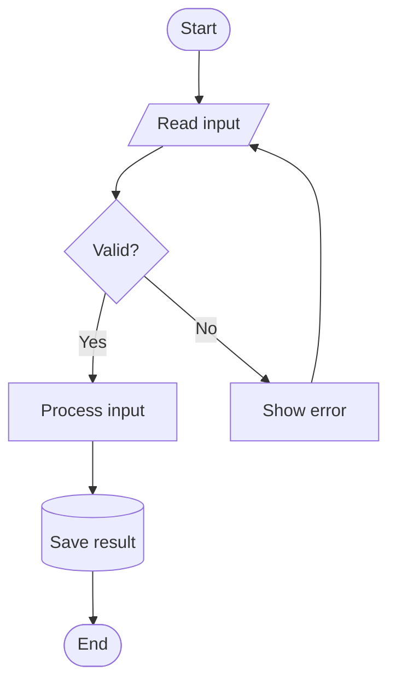
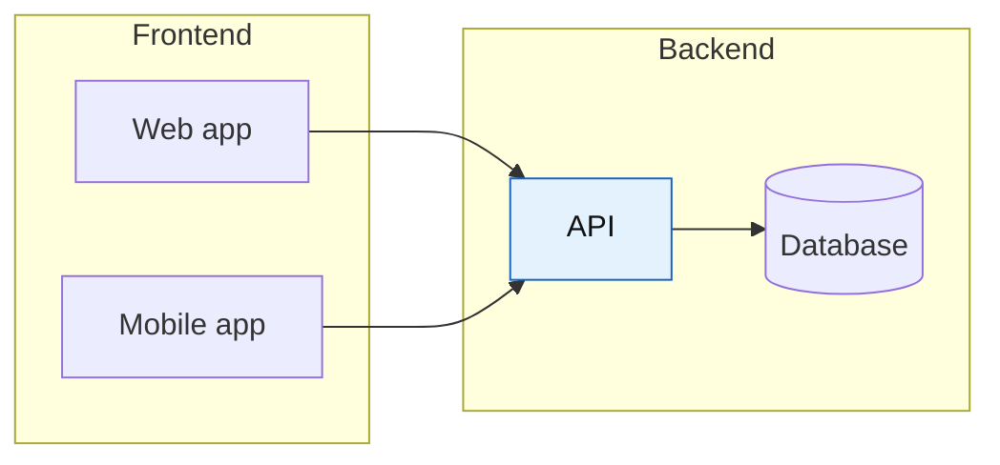

# Flowcharts

Use a flowchart for steps and decisions. Preserve the supplied process; syntax examples below are illustrative rather than an application design.

## Nodes and edges

Use `TD`/`TB`, `BT`, `LR`, or `RL` for direction. Keep stable IDs separate from visible labels.

| Shape | Syntax |
| --- | --- |
| Rectangle | `a["Step"]` |
| Rounded rectangle | `a("Step")` |
| Stadium | `a(["Start or end"])` |
| Subroutine | `a[["Subroutine"]]` |
| Cylinder | `a[("Database")]` |
| Circle | `a(("Event"))` |
| Decision | `a{"Condition?"}` |
| Hexagon | `a{{"Preparation"}}` |
| Asymmetric | `a>"Flag"]` |
| Parallelogram | `a[/"Input/output"/]` or `a[\"Input/output"\]` |
| Trapezoid | `a[/"Step"\]` or `a[\"Step"/]` |

Connections include `a --> b` (arrow), `a --- b` (line), `a -.-> b` (dotted arrow), `a ==> b` (thick arrow), and `a -->|Label| b`. Chaining (`a --> b --> c`) and fan-out (`a --> b & c`) are supported, but separate edges are easier to annotate and review.

## Groups and styling

A subgraph's local direction may be ignored when its internal nodes connect outside it. Inspect the resulting layout; declaration order and direction are hints rather than exact coordinates.

Use `style api fill:#e3f2fd,stroke:#1565c0` for a single node. `linkStyle 0 stroke:#1565c0,stroke-width:2px` styles the first declared edge; numeric edge indices can become stale when edges are reordered.

## Syntax and readability pitfalls

- Quote labels containing punctuation or Unicode. Use stable IDs without punctuation rather than putting a display label in an ID.
- Lowercase `end` can conflict with syntax; use `End` in labels. A leading `o` or `x` immediately after an edge can be interpreted as an endpoint marker, so separate the ID with whitespace.
- `%%` introduces a comment through the end of the line. Avoid directive-like `%%{...}%%` in ordinary comments; comments do not create visible annotations.
- Prefer short labels and one readable flow over dense chains. Split views only when it improves the requested explanation.
- New shapes and Markdown labels require compatible versions; use the target renderer's syntax rather than assuming every host supports them.

For interactions supported by the host, flowchart links use `click api "https://example.com/api" "API documentation"`. The `link A: ... @ ...` syntax belongs to sequence participant menus, not flowcharts. Hosts may disable interactions; do not relax their security settings to make a diagram work.

See [official flowchart syntax](https://mermaid.js.org/syntax/flowchart.html) for additional shapes and version-specific features, and [configuration/export](advanced-features.md) for rendering.
