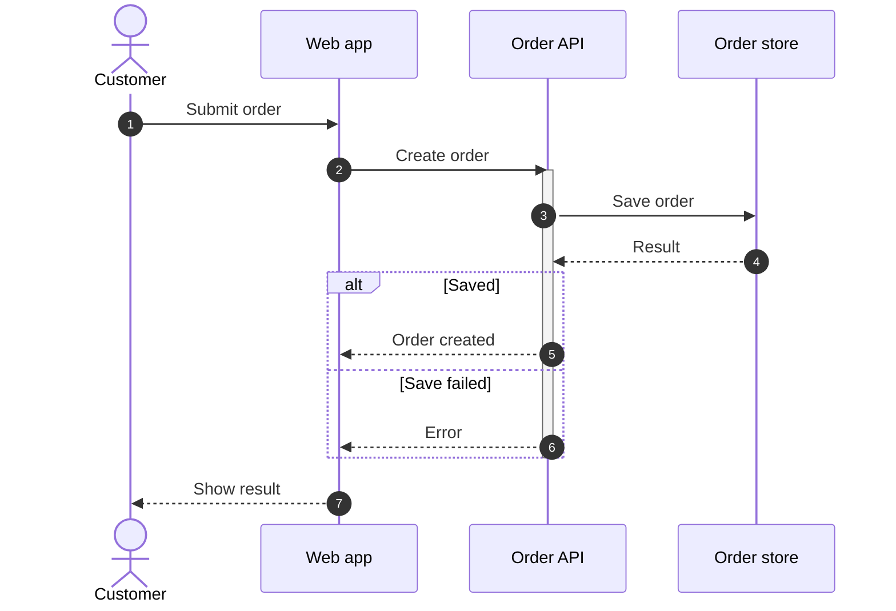
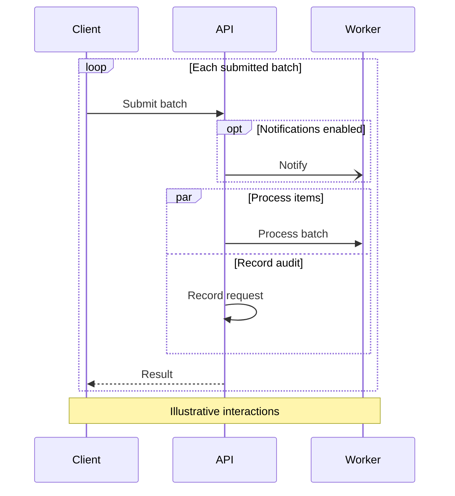

# Sequence diagrams

Use a sequence diagram to show interactions in time. Declare participants in the intended horizontal order; use aliases for long names.

## Messages, activations, and notes

| Syntax | Appearance or use |
| --- | --- |
| `A->>B: Request` | Solid line, arrowhead |
| `B-->>A: Result` | Dotted line, arrowhead |
| `A->B: Message` | Solid line, no arrowhead |
| `A-)B: Event` | Solid line, open arrow for asynchronous messages |
| `A--)B: Event` | Dotted line, open arrow |
| `A-xB: Message` | Solid line, cross endpoint |
| `A--xB: Message` | Dotted line, cross endpoint |
| `A->>+B: Request` | Activates B |
| `B-->>-A: Result` | Deactivates B |
| `Note right of B: Detail` | Note beside B |
| `Note over A,B: Shared detail` | Note spanning A and B |

Use arrow conventions consistently, but do not infer synchronous behavior, delivery guarantees, or participant destruction from an arrow shape alone. A cross endpoint is not the `destroy` directive. Explicit `activate`/`deactivate` is often clearer around branching flows. Balance activations along the diagram's declaration sequence; alternative branches do not provide independent activation stacks.

## Fragments

- `alt condition` / `else other condition` / `end`: mutually exclusive paths.
- `opt condition` / `end`: optional interaction.
- `loop condition` / `end`: repeated interaction.
- `par description` / `and description` / `end`: parallel interactions.
- `break condition` / `end`: exceptional interruption; ensure subsequent messages are consistent with its meaning.

`autonumber` helps reference messages in prose. `Note left of`, `Note right of`, and `Note over` add visible context. Use line breaks supported by the destination, commonly ` `, for long notes and aliases.

Participant menus can use `link API: Documentation @ https://example.com/api` when supported by the host; this is not flowchart link syntax. Avoid introducing links or interactive behavior when only a static diagram is requested.

## Checks

Render nested fragments and activation changes. Check message order, arrow direction, branch labels, note overlap, and text size. If the literal word `end` causes parsing problems in message text, enclose it as `(end)` or rephrase it; keep block-closing `end` statements intact. Show only the success, failure, and concurrent paths relevant to the request.

See [official sequence syntax](https://mermaid.js.org/syntax/sequenceDiagram.html) for `critical`, participant creation/destruction, and other version-specific features.
